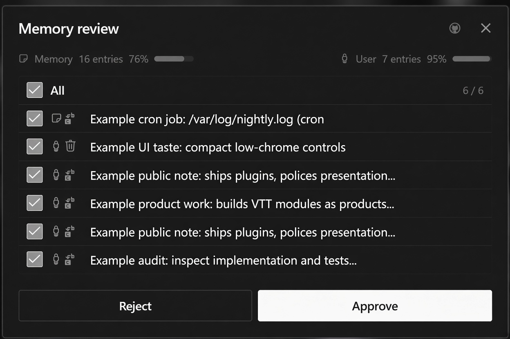
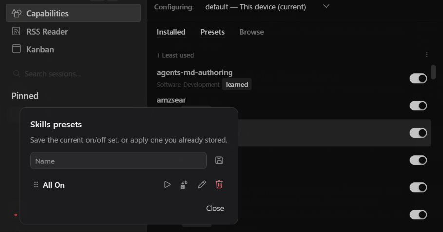
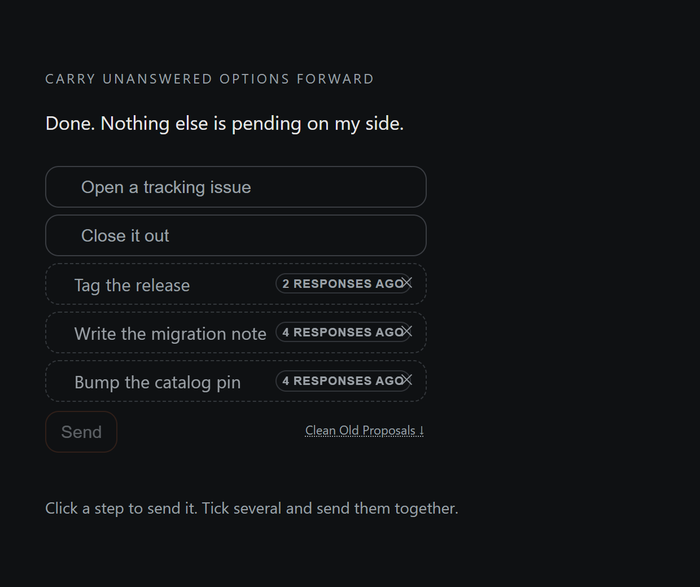
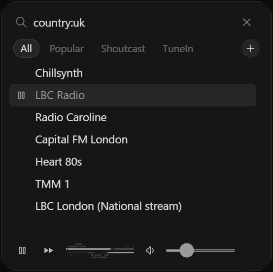
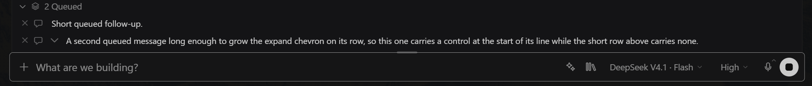
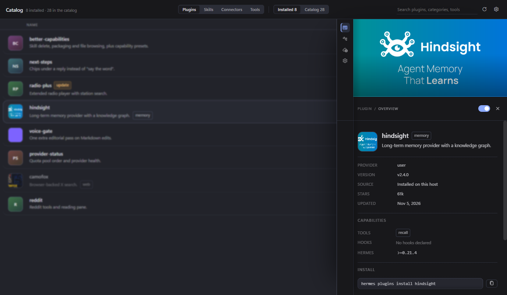

<!-- markdownlint-disable MD033 -->

<div align="center">
  <a href="https://github.com/NousResearch/hermes-agent">
    
  </a>
</div>

<div align="center">

  <h1>Hermes Agent Awesome Plugins</h1>

  <p>Plugins for Hermes Desktop: provider limits, long sessions, feeds, memory, the Windows desktop itself, and the agent's habit of doing everything in one thread. Twenty-six plugins, twenty-five with a public edition.</p>

  <p>
    <a href="#readme"></a>
    <a href="https://github.com/apoapostolov/hermes-agent-awesome-plugins"></a>
    <a href="https://github.com/apoapostolov/hermes-agent-awesome-plugins/releases"></a>
    <a href="https://github.com/apoapostolov/hermes-agent-awesome-plugins/releases"></a>
    <a href="./LICENSE"></a>
  </p>

</div>

<div align="center">
  
</div>

## Latest plugin update
**Provider Status 1.6.10** reads Kimi Code membership keys (`sk-kimi-…`) against the coding quota endpoint Hermes core already uses for them. The old Moonshot balance endpoint returned `HTTP 401` for those keys, so the chip showed `error` and the settings badge `HTTP 401` even though the key worked. The chip now shows monthly quota remaining with a 5-hour row and a reset countdown, and `KIMI_API_KEY` and `KIMI_CODING_API_KEY` are recognised. Network errors and unexpected HTTP statuses return an error status rather than an `UnboundLocalError` in the chip. Both editions carry it. Update the plugin and restart Hermes Desktop once.

**Intelligent Tool Break 1.3.7** fixes the composer strip staying empty during a tool call when Desktop's runtime session id differs from the assistant session id. The strip used the runtime id as an explicit `/break-status --session-id` filter, which overrode the calling session and matched no tracked tools; it now routes the command with the runtime id and lets the handler scope to the assistant session. Update both editions and restart Hermes Desktop once.

**Prompt Enhance 1.2.1** keeps the Prompt Library and Edit dialogs open when a click lands inside them but its accessibility target resolves to the overlay, which used to close the dialog before Import Prompt received the click. The guard checks pointer coordinates against the dialog's own root instead of the event target, and a Tab that escapes the focus trap no longer closes it either; a normal click outside still closes the dialog. Both editions carry it. Update the plugin and restart Hermes Desktop once.

**Jev Routing 1.1.2** sends an explicit `User-Agent` on every classification call. Cloudflare's Browser Integrity Check in front of `opencode.ai` answers urllib's default client signature with `HTTP 403` and `error code: 1010`, so on an affected host every turn failed open and routing never ran: in shadow mode the only symptom was a missing tier line and no savings. The header lives in the transport, which also carries `/jev-routing` and the `jev_route` tool, and a caller that supplies its own agent keeps it. Both editions carry the change, and this is the first tagged build that also leaves a cron turn unrouted instead of holding it, which had interrupted scheduled jobs; update the plugin and restart the backend once.

**Delegation Nudge 1.3.0** is listed for the first time, as `hermes-delegation-nudge` in the Hermes plugin catalog, from a public edition that carries the same middleware as the personal build with nothing cut: one `llm_request` middleware, three hooks and a single read of `config.yaml`, with no app DOM, no writes and no network calls. It is the first plugin in this pack whose whole job is the agent's own habits rather than a surface. Past ten tool results in a turn with no dispatch it appends one note to the turn's user message naming the routes from your model map, with provider, model and free or cheap on each; at twenty-five results a second note names the bill in context carried. The note also asks the turn to dispatch or say in one sentence why not, which is what makes a decline readable later. Both editions gain the engraving above and a written record in the changelog.

**Session Retitler 1.1.4** writes session titles through Hermes' published storage interface instead of private core helpers, so a future core change can no longer turn an automatic rename into a title that looks user-set. A rename is now skipped entirely when the existing title's source cannot be read, and the background rename runs under the active profile so a multi-profile gateway uses the right model route and session store. The counter, digest, user-title wall and 10-message default are unchanged; update and restart the backend once.

**Radio Plus 1.5.4** writes its station log under the active Hermes home's `plugin-data/radio-plus` directory and checks every outbound stream address and redirect with Hermes' URL-safety policy, so a profile-scoped backend cannot log to the wrong home and the probe and track-title routes cannot be used to reach a private network. Nothing in the picker changes. Reinstall or update both editions; the backend restart is still yours.

**Next Steps 1.1.6** keeps action choices on rounded chips. A model used the retired `answer` argument on a decision sheet, so the reply drew labelled reply fields where chips were expected; the `next_steps` tool no longer exposes that argument, and its handler always registers a chip block. The agent prompt no longer teaches answer mode. The `answer="1"` directive still draws the reply-field form for replies that genuinely ask for several typed answers. Both editions ship the change. A new session is needed for the frozen prompt and tool list to pick it up; the renderer is unchanged.

Restart Hermes Desktop after updating; the Python and desktop halves do not reload in place.

## In the app

These are captures from the running app of the parts that only make sense in place: the providers dialog, the reader, the memory review queue, skills presets, the session list, the turn meter and the composer queue. Ten plugins carry one; the settings for every plugin that has a settings page live under Settings, Plugins, and each plugin README shows its own.

<div align="center">
<table>
  <tr>
    <td align="center" valign="top" width="33%"><a href="personal/provider-status"></a><br /><sub><a href="personal/provider-status"><strong>Provider Status</strong></a><br />The providers dialog: quota dots, extra keys, rotation</sub></td>
    <td align="center" valign="top" width="33%"><a href="personal/rss-reader"></a><br /><sub><a href="personal/rss-reader"><strong>RSS Reader</strong></a><br />Three columns: folders, article list, reader pane</sub></td>
    <td align="center" valign="top" width="33%"><a href="personal/memory-review"></a><br /><sub><a href="personal/memory-review"><strong>Memory Review</strong></a><br />Staged memory writes waiting for Approve or Reject</sub></td>
  </tr>
  <tr>
    <td align="center" valign="top" width="33%"><a href="personal/better-capabilities"></a><br /><sub><a href="personal/better-capabilities"><strong>Better Capabilities</strong></a><br />Skills presets saved from the current on/off set</sub></td>
    <td align="center" valign="top" width="33%"><a href="personal/better-session-appearance"></a><br /><sub><a href="personal/better-session-appearance"><strong>Better Session Appearance</strong></a><br />Color picker, icon grid and Auto Rules</sub></td>
    <td align="center" valign="top" width="33%"><a href="personal/iteration-budget-meter"></a><br /><sub><a href="personal/iteration-budget-meter"><strong>Iteration Budget Meter</strong></a><br />Per-turn usage and request statistics</sub></td>
  </tr>
  <tr>
    <td align="center" valign="top" width="33%"><a href="personal/hermes-next-steps"></a><br /><sub><a href="personal/hermes-next-steps"><strong>Next Steps</strong></a><br />Unanswered options carried under a later reply</sub></td>
    <td align="center" valign="top" width="33%"><a href="personal/radio-plus"></a><br /><sub><a href="personal/radio-plus"><strong>Radio Plus</strong></a><br />Listen to your own radios, search by country or genre.</sub></td>
    <td align="center" valign="top" width="33%"><a href="personal/queue-container-fix"></a><br /><sub><a href="personal/queue-container-fix"><strong>Queue Container Fix</strong></a><br />Queued prompt controls at the start of the line</sub></td>
  </tr>
  <tr>
    <td align="center" valign="top" width="33%"><a href="personal/catalog-redesign"></a><br /><sub><a href="personal/catalog-redesign"><strong>Catalog Redesign</strong></a><br />Four kinds in one list, panel open on a hero</sub></td>
  </tr>
</table>
</div>

## Personal and public

This repository keeps two trees.

**[personal/](personal/README.md)** is the full-featured edition I run. These builds may reach into Hermes Desktop internals: app DOM, persisted app keys, raw bridge calls. A Desktop update can break them. They sit outside the plugin SDK contract, so install them only if you accept that risk. The pack pins this tree.

**[public/](public/README.md)** is the catalog edition. These builds stay inside the Hermes plugin SDK (`ctx.register*`, `host.state` / `host.request`, `ctx.storage`, `ctx.rest`) so they can be listed. When Desktop has no hook yet, the public copy drops that surface. All but Queue Container Fix have one, because that plugin is entirely a restyle of app markup.

```bash
hermes plugins install apoapostolov/hermes-agent-awesome-plugins/personal/<id>
hermes plugins install apoapostolov/hermes-agent-awesome-plugins/public/<id>
```

The pack command in [Install](#install) pulls `personal/<id>`.

Agent rules for these trees live in [AGENTS.md](AGENTS.md). Catalog blockers for the personal editions live in each plugin's `LIMITATIONS.md`.

## What's in the Pack

Each row links the personal edition you get from the pack, plus the public catalog edition where one exists.

Twenty plugins are pinned in `hermes-pack.yaml` (pack version 1.27.33). Six plugins in the repo are not in the pack: **better-capabilities**, **byparr-mcp**, **byparr-tools**, **prompt-enhance**, **queue-container-fix**, and **voice-gate**. Install any of them separately. The pack pins the personal tree for those twenty.

### Status Bar

| Plugin | What you get |
| --- | --- |
| [Provider Status](personal/provider-status/README.md) · [public](public/provider-status/README.md) | Status-bar quota used/remaining. DeepSeek and GLM peak/off-peak gauges with countdowns. Multi-account. Rotate on low quota or reset day. Grok/Codex OAuth. Providers: Tavily, OpenCode Go, DeepSeek, GLM (z.ai), OpenRouter, Grok (xAI), Codex (OpenAI), OpenAI, Anthropic, Groq, Cerebras, Moonshot Kimi, MiniMax, Google Gemini, Hugging Face, Mistral, Qwen. Kimi Code membership keys report their coding quota. |
| [Iteration Budget Meter](personal/iteration-budget-meter/README.md) · [public](public/iteration-budget-meter/README.md) | Per-turn N/budget while work runs. Hover and click for request stats. |
| [Reasoning Switch](personal/reasoning-switch/README.md) · [public](public/reasoning-switch/README.md) | Cycle reasoning effort from the status bar, with colors and per-level prompt demote. |
| [Radio Plus](personal/radio-plus/README.md) · [public](public/radio-plus/README.md) | Live radio with a station list you own: edit a name and a stream address, add any stream, search Radio Browser, its popular list, the Shoutcast directory and TuneIn, see the track the stream announces, play HLS through a bundled hls.js (personal edition), and read why a station failed. An extended edition of the bundled Radio plugin. |

### Tools and Memory

| Plugin | What you get |
| --- | --- |
| [Intelligent Tool Break](personal/intelligent-tool-break/README.md) · [public](public/intelligent-tool-break/README.md) | `/break`, `/break {msg}`, and `/again`. Desktop strip. Turn stays alive. |
| [Vercel Agent Desktop Support](personal/vercel-agent-desktop-support/README.md) · [public](public/vercel-agent-desktop-support/README.md) | Operate Windows apps through the accessibility tree: click, fill, select, toggle, scroll, key combos, windows, clipboard. Headless by default, so it never takes focus or the cursor. **Windows only.** |
| [Memory Review](personal/memory-review/README.md) · [public](public/memory-review/README.md) | Checkbox staged memory writes. Approve or reject from a dialog. |
| [CDP Manager](personal/cdp-manager/README.md) · [public](public/cdp-manager/README.md) | Launch, stop, and recheck local Chrome CDP ports from the status bar, with a profile per port and one port a backend supervisor keeps alive. The `cdp` tool does the same from chat and repairs a Chrome profile-picker launch. |
| [Delegation Nudge](personal/delegation-nudge/README.md) · [public](public/hermes-delegation-nudge/README.md) | A live reminder when a turn keeps working inline: past ten tool results with no dispatch, the model gets one note naming the routes it would use, read from the configured model map with provider, model and price, and a second note at twenty-five results naming the bill. It asks the turn to dispatch or say why not, so a decline is recorded instead of silently taken. Silent in subagents, silent after a dispatch, two notes per turn at most. |
| [Jev Routing](personal/hermes-jev-routing/README.md) · [public](public/hermes-jev-routing/README.md) | Per-turn model routing from TypeSafe Jev. The listed edition rewrites the model and the reasoning level on the request the turn is already bound to, and reports a pick on another provider rather than sending it; the personal edition moves the live session and also reads the provider catalogue, Codex quota and private pricing. |
| [Byparr Tools](personal/byparr-tools/README.md) · [public](public/byparr-tools/README.md) | Call a FlareSolverr-compatible solver from Hermes: fetch solved HTML, bridge challenge cookies into a browser over CDP, extract structured data, and check solver health. **Not in the pack; install separately.** |
| [Byparr MCP](personal/byparr-mcp/README.md) · [public](public/byparr-mcp/README.md) | Expose a FlareSolverr-compatible solver as MCP tools for Codex, mcporter, and other MCP clients. **Not in the pack; install separately.** |

### Capabilities and catalog

| Plugin | What you get |
| --- | --- |
| [Catalog Redesign](personal/catalog-redesign/README.md) · [public](public/catalog-redesign/README.md) | One wide row per skill, plugin, connector and tool, with a hover preview, real artwork from the catalog or the plugin's own folder, and a detail panel that carries the hero image, a section rail and the on/off switch. Switches on plugins, skills, toolsets and connectors. Leaves the native Capabilities page alone. |
| [Better Capabilities](personal/better-capabilities/README.md) · [public](public/better-capabilities/README.md) | Delete and package skills, browse skill files, and save on/off presets for skills, toolsets, and agent plugins. **Not in the pack; install separately.** |

### Sessions and Sidebar

| Plugin | What you get |
| --- | --- |
| [Better Session Appearance](personal/better-session-appearance/README.md) · [public](public/better-session-appearance/README.md) | Idle color, bold, and icons: one for the idle dot, or one for each of the six status dots. A settings switch lets the in-progress dots wear the session color. Auto Rules by title keywords. |
| [Sidebar Manager](personal/sidebar-manager/README.md) · [public](public/sidebar-manager/README.md) | Hide and reorder nav rows and session sections. |
| [Drag to Pin Session](personal/drag-to-pin-session/README.md) · [public](public/drag-to-pin-session/README.md) | Drag pin/unpin with lasting order. |
| [Session Retitler](personal/sessionretitler/README.md) · [public](public/sessionretitler/README.md) | Retitles the session every N titleable user messages, from the latest exchanges. A title you set yourself is never touched. |
| [Scroll on Switch](personal/scroll-on-switch/README.md) · [public](public/scroll-on-switch/README.md) | Snap to bottom on session switch. Does not fight streaming. |

### Composer

| Plugin | What you get |
| --- | --- |
| [Opaque Composer](personal/opaque-composer/README.md) · [public](public/opaque-composer/README.md) | Solid composer while the transcript scrolls behind it. |
| [Queue Container Fix](personal/queue-container-fix/README.md) | Moves a queued prompt's expand, edit, steer and send controls from the end of the row to the start of its first line, visible without hovering. Personal only: it restyles app markup. |
| [Next Steps](personal/hermes-next-steps/README.md) · [public](public/hermes-next-steps/README.md) | Clickable next steps under a reply: tick several and one send delivers them together, a directive-only answer form puts a reply field beside each question and sends numbered answers back, a small Steer button sends the picks into a running turn instead of queueing them, a Recommended tag on the options worth taking now, an amber RISKY pill on the ones that could damage something, a dim second line where a label alone would misread, and carried-forward options from earlier replies. The personal edition animates the chip border while a reply works and jumps back to the reply that offered a carried option. |
| [Prompt Enhance](personal/prompt-enhance/README.md) · [public](public/prompt-enhance/README.md) | Rewrite a composer draft from a saved prompt library and put the finished prompt back in the field. **Not in the pack; enable separately.** |

### Writing

| Plugin | What you get |
| --- | --- |
| [Voice Gate](personal/voice-gate/README.md) · [public](public/voice-gate/README.md) | Reviews changed prose with 75 mechanical families and optional model review against all 110 humanizer patterns. Protects source material, limits revision requests to two opportunities, and supports Vale from an executable you approved, file exceptions, writing contexts, and a grouped settings page. Personal also loads approved writing profiles, drafts profiles from curated samples, and records bounded local diagnostics. **Not in the pack; install separately.** |

### Reading and posting

| Plugin | What you get |
| --- | --- |
| [RSS Reader](personal/rss-reader/README.md) · [public](public/rss-reader/README.md) | Three-column reader. Folders, mute/search, capture. Optional Hermes tools and ticker. |
| [Reddit](personal/reddit/README.md) · [public](public/reddit/README.md) | Account access, a searchable local save library with source summaries and notes, a Desktop browser, background cleanup and 22 reading/management tools. Standalone release; catalog admission is blocked by missing host OAuth transport. |

The six plugins not in the pack are **better-capabilities**, **byparr-mcp**, **byparr-tools**, **prompt-enhance**, **queue-container-fix**, and **voice-gate**. Everything else in the tables above is pinned by the pack.

Retired and on-hold plugins live in [RETIRED.md](RETIRED.md).

## Install

Requires [Hermes Agent](https://github.com/NousResearch/hermes-agent) **0.21.0 or newer**.

```bash
hermes plugins pack install https://raw.githubusercontent.com/apoapostolov/hermes-agent-awesome-plugins/main/hermes-pack.yaml
```

Each plugin keeps its own capability consent. Packs do not bulk-grant. Secrets stay `requires_env` and are never embedded in the pack.

Verify:

```bash
hermes plugins list
hermes plugins pack show https://raw.githubusercontent.com/apoapostolov/hermes-agent-awesome-plugins/main/hermes-pack.yaml
```

For a single plugin, follow that plugin's README. For **prompt-enhance**, use its README because the pack does not install it.

## How It Works

`hermes-pack.yaml` pins each pack entry to `repo` + `subdir` + an exact 40-character commit. Hermes expands those into ordinary plugin installs. What you get matches the pinned SHAs, not whichever tip happens to be on `main` that day.

Most plugins are desktop-only. Check the individual README for platform and surface limits.

## Requirements and Limits

- Hermes Agent **0.21.0 or newer** for shareable plugin packs.
- Windows, macOS, or Linux for the pack itself.
- Individual plugins may need a narrower desktop surface or a full Desktop quit/reopen after first install.
- Provider services keep their own usage limits and costs.

This is an independent community project. It does not change Hermes Agent core, bulk-grant capabilities, or silently send plugin data elsewhere. Per-plugin data handling is in each README.

## Documentation

- [Personal editions](personal/README.md)
- [Public editions](public/README.md)
- [AGENTS.md](AGENTS.md): personal/public backport and version rules
- [Better Capabilities](personal/better-capabilities/README.md) (not in the pack)
- [Better Session Appearance](personal/better-session-appearance/README.md)
- [Byparr MCP](personal/byparr-mcp/README.md) (not in the pack)
- [Byparr Tools](personal/byparr-tools/README.md) (not in the pack)
- [Catalog Redesign](personal/catalog-redesign/README.md)
- [CDP Manager](personal/cdp-manager/README.md)
- [Delegation Nudge](personal/delegation-nudge/README.md) · [public edition](public/hermes-delegation-nudge/README.md)
- [Drag to Pin Session](personal/drag-to-pin-session/README.md)
- [Intelligent Tool Break](personal/intelligent-tool-break/README.md)
- [Iteration Budget Meter](personal/iteration-budget-meter/README.md)
- [Jev Routing](personal/hermes-jev-routing/README.md)
- [Memory Review](personal/memory-review/README.md)
- [Next Steps](personal/hermes-next-steps/README.md)
- [Opaque Composer](personal/opaque-composer/README.md)
- [Prompt Enhance](personal/prompt-enhance/README.md) (not in the pack)
- [Provider Status](personal/provider-status/README.md)
- [Queue Container Fix](personal/queue-container-fix/README.md) (not in the pack)
- [Radio Plus](personal/radio-plus/README.md)
- [Reasoning Switch](personal/reasoning-switch/README.md)
- [Reddit](personal/reddit/README.md)
- [RSS Reader](personal/rss-reader/README.md)
- [Scroll on Switch](personal/scroll-on-switch/README.md)
- [Session Retitler](personal/sessionretitler/README.md)
- [Sidebar Manager](personal/sidebar-manager/README.md)
- [Vercel Agent Desktop Support](personal/vercel-agent-desktop-support/README.md)
- [Voice Gate](personal/voice-gate/README.md) (not in the pack)

## Support

Report problems or follow releases through [@ApoMakesMods](https://x.com/ApoMakesMods) on X.

## License

[MIT](LICENSE) © Apostol Apostolov

This is an independent community project. It is not affiliated with, endorsed by, sponsored by, or officially associated with Nous Research or Hermes Agent. Hermes, Hermes Agent, and Nous Research are names and marks belonging to their respective owners.
