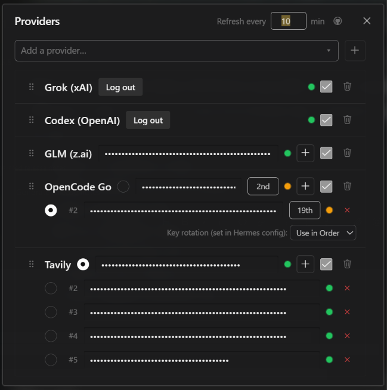
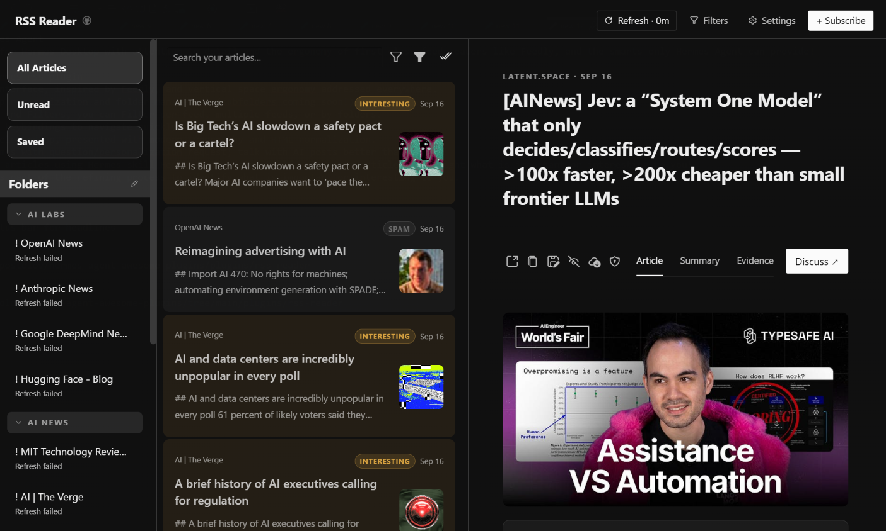
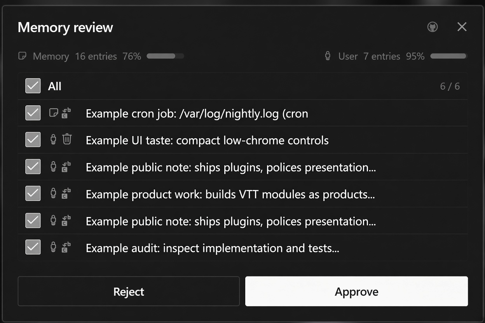
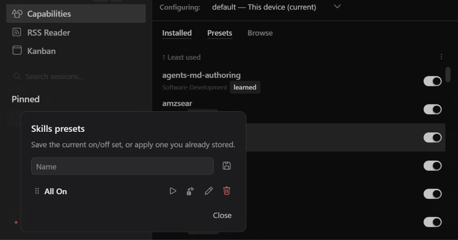
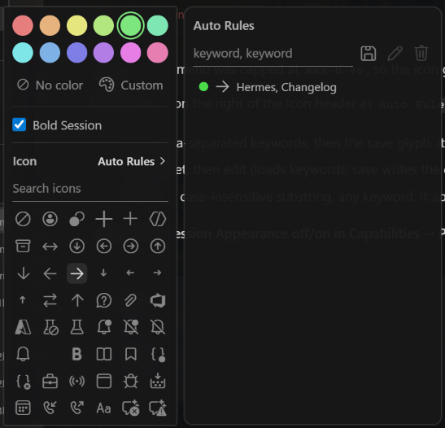
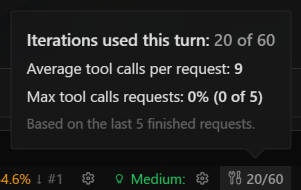

<!-- markdownlint-disable MD033 -->

<div align="center">
  <a href="https://github.com/NousResearch/hermes-agent">
    
  </a>
</div>

<div align="center">

  <h1>Hermes Agent Awesome Plugins</h1>

  <p>Give Hermes Desktop useful tools for provider limits, long sessions, feeds, memory, and the Windows desktop itself. Nineteen plugins. Every one has a public edition.</p>

  <p>
    <a href="#readme"></a>
    <a href="./package.json"></a>
    <a href="https://github.com/apoapostolov/hermes-agent-awesome-plugins/releases"></a>
    <a href="https://github.com/apoapostolov/hermes-agent-awesome-plugins/releases"></a>
    <a href="./LICENSE"></a>
  </p>

</div>

<div align="center">
  
</div>

## Latest plugin update

Voice Gate 1.4.4 starts Vale with a short list of variables instead of the host's environment, so a downloaded binary no longer inherits the provider keys the gateway holds. Plugin data and voice-profile lookup now follow the profile the host is serving, and turn-time Vale findings run only an executable you approved once through the tool, matched by digest. The settings-page note about Hermes Desktop 0.22.8 is gone, because `hideAgentSettings` has no implementation in Hermes yet. Both editions carry the fixes; the personal edition keeps its local diagnostics.

Restart Hermes Desktop after updating; the Python and desktop halves do not reload in place.

The pack is at 1.24.0. See the [changelog](CHANGELOG.md) for plugin-level updates and the distinction between personal and public builds.

## In the app

These are captures from the running app of the parts that only make sense in place: the providers dialog, the reader, the memory review queue, skills presets, the session list and the turn meter. Six plugins carry one; the settings for every plugin that has a settings page live under Settings, Plugins, and each plugin README shows its own.

<div align="center">
<table>
  <tr>
    <td align="center" valign="top" width="33%"><a href="personal/provider-status"></a><br /><sub><a href="personal/provider-status"><strong>Provider Status</strong></a><br />The providers dialog: quota dots, extra keys, rotation</sub></td>
    <td align="center" valign="top" width="33%"><a href="personal/rss-reader"></a><br /><sub><a href="personal/rss-reader"><strong>RSS Reader</strong></a><br />Three columns: folders, article list, reader pane</sub></td>
    <td align="center" valign="top" width="33%"><a href="personal/memory-review"></a><br /><sub><a href="personal/memory-review"><strong>Memory Review</strong></a><br />Staged memory writes waiting for Approve or Reject</sub></td>
  </tr>
  <tr>
    <td align="center" valign="top" width="33%"><a href="personal/better-capabilities"></a><br /><sub><a href="personal/better-capabilities"><strong>Better Capabilities</strong></a><br />Skills presets saved from the current on/off set</sub></td>
    <td align="center" valign="top" width="33%"><a href="personal/better-session-appearance"></a><br /><sub><a href="personal/better-session-appearance"><strong>Better Session Appearance</strong></a><br />Color picker, icon grid and Auto Rules</sub></td>
    <td align="center" valign="top" width="33%"><a href="personal/iteration-budget-meter"></a><br /><sub><a href="personal/iteration-budget-meter"><strong>Iteration Budget Meter</strong></a><br />Per-turn usage and request statistics</sub></td>
  </tr>
</table>
</div>

## Personal and public

This repository keeps two trees.

**[personal/](personal/README.md)** is the full-featured edition I run. These builds may reach into Hermes Desktop internals: app DOM, persisted app keys, raw bridge calls. A Desktop update can break them. They sit outside the plugin SDK contract, so install them only if you accept that risk. The pack pins this tree.

**[public/](public/README.md)** is the catalog edition. These builds stay inside the Hermes plugin SDK (`ctx.register*`, `host.state` / `host.request`, `ctx.storage`, `ctx.rest`) so they can be listed. When Desktop has no hook yet, the public copy drops that surface. All 19 active plugins have one.

```bash
hermes plugins install apoapostolov/hermes-agent-awesome-plugins/personal/<id>
hermes plugins install apoapostolov/hermes-agent-awesome-plugins/public/<id>
```

The pack command in [Install](#install) pulls `personal/<id>`.

Agent rules for these trees live in [AGENTS.md](AGENTS.md). Catalog blockers for the personal editions live in each plugin's `LIMITATIONS.md`.

## What's in the Pack

Each row links the personal edition you get from the pack, plus the public catalog edition where one exists.

Fourteen plugins are pinned in `hermes-pack.yaml` (pack version 1.24.0). **better-capabilities**, **reasoning-switch**, **prompt-enhance**, **hermes-jev-routing**, and **voice-gate** live in this repo but are **not** in the pack, so install any of them separately if you want it. The pack pins the personal tree for all fourteen.

### Status Bar

| Plugin | What you get |
| --- | --- |
| [Provider Status](personal/provider-status/README.md) · [public](public/provider-status/README.md) | Status-bar quota used/remaining. DeepSeek and GLM peak/off-peak gauges with countdowns. Multi-account. Rotate on low quota or reset day. Grok/Codex OAuth. Providers: Tavily, OpenCode Go, DeepSeek, GLM (z.ai), OpenRouter, Grok (xAI), Codex (OpenAI), OpenAI, Anthropic, Groq, Cerebras, Moonshot Kimi, MiniMax, Google Gemini, Hugging Face, Mistral, Qwen. |
| [Iteration Budget Meter](personal/iteration-budget-meter/README.md) · [public](public/iteration-budget-meter/README.md) | Per-turn N/budget while work runs. Hover and click for request stats. |
| [Reasoning Switch](personal/reasoning-switch/README.md) · [public](public/reasoning-switch/README.md) | Cycle reasoning effort from the status bar, with colors and per-level prompt demote. **Not in the pack; enable separately.** |

### Tools and Memory

| Plugin | What you get |
| --- | --- |
| [Intelligent Tool Break](personal/intelligent-tool-break/README.md) · [public](public/intelligent-tool-break/README.md) | `/break`, `/break {msg}`, and `/again`. Desktop strip. Turn stays alive. |
| [Vercel Agent Desktop Support](personal/vercel-agent-desktop-support/README.md) · [public](public/vercel-agent-desktop-support/README.md) | Operate Windows apps through the accessibility tree: click, fill, select, toggle, scroll, key combos, windows, clipboard. Headless by default, so it never takes focus or the cursor. **Windows only.** |
| [Memory Review](personal/memory-review/README.md) · [public](public/memory-review/README.md) | Checkbox staged memory writes. Approve or reject from a dialog. |
| [CDP Manager](personal/cdp-manager/README.md) · [public](public/cdp-manager/README.md) | Launch, stop, and recheck local Chrome CDP ports from the status bar, with a profile per port and one port a backend supervisor keeps alive. The `cdp` tool does the same from chat and repairs a Chrome profile-picker launch. |
| [Jev Routing](personal/hermes-jev-routing/README.md) · [public](public/hermes-jev-routing/README.md) | Per-turn model routing from TypeSafe Jev. The listed edition rewrites the model and the reasoning level on the request the turn is already bound to, and reports a pick on another provider rather than sending it; the personal edition moves the live session and also reads the provider catalogue, Codex quota and private pricing. **Not in the pack; enable separately.** |

### Sessions and Sidebar

| Plugin | What you get |
| --- | --- |
| [Better Session Appearance](personal/better-session-appearance/README.md) · [public](public/better-session-appearance/README.md) | Idle color, bold, and icons: one for the idle dot, or one for each of the six status dots. A settings switch lets the in-progress dots wear the session color. Auto Rules by title keywords. |
| [Sidebar Manager](personal/sidebar-manager/README.md) · [public](public/sidebar-manager/README.md) | Hide and reorder nav rows and session sections. |
| [Drag to Pin Session](personal/drag-to-pin-session/README.md) · [public](public/drag-to-pin-session/README.md) | Drag pin/unpin with lasting order. |
| [Session Retitler](personal/sessionretitler/README.md) · [public](public/sessionretitler/README.md) | Retitles the session every N titleable user messages, from the latest exchanges. A title you set yourself is never touched. |
| [Scroll on Switch](personal/scroll-on-switch/README.md) · [public](public/scroll-on-switch/README.md) | Snap to bottom on session switch. Does not fight streaming. |

### Composer

| Plugin | What you get |
| --- | --- |
| [Opaque Composer](personal/opaque-composer/README.md) · [public](public/opaque-composer/README.md) | Solid composer while the transcript scrolls behind it. |
| [Prompt Enhance](personal/prompt-enhance/README.md) · [public](public/prompt-enhance/README.md) | Rewrite a composer draft from a saved prompt library and put the finished prompt back in the field. **Not in the pack; enable separately.** |

### Writing

| Plugin | What you get |
| --- | --- |
| [Voice Gate](personal/voice-gate/README.md) · [public](public/voice-gate/README.md) | Reviews changed prose with 75 mechanical families and optional model review against all 110 humanizer patterns. Protects source material, limits revision requests to two opportunities, and supports Vale from an executable you approved, file exceptions, writing contexts, and a grouped settings page. Personal also loads approved writing profiles, drafts profiles from curated samples, and records bounded local diagnostics. **Not in the pack; install separately.** |

### Reading and posting

| Plugin | What you get |
| --- | --- |
| [RSS Reader](personal/rss-reader/README.md) · [public](public/rss-reader/README.md) | Three-column reader. Folders, mute/search, capture. Optional Hermes tools and ticker. |
| [Reddit](personal/reddit/README.md) · [public](public/reddit/README.md) | Your own Reddit app and account: OAuth login, reads of public subreddits, search, user history and threads that keep their reply tree before any login, then private subreddits, saved items, the inbox, posts, comments, votes and subscriptions as the account, plus `reddit_api` for any other endpoint. |

Five plugins in this repo are not in the pack and are installed separately: **better-capabilities**, **reasoning-switch** (Status Bar table), **prompt-enhance** (Composer table), **hermes-jev-routing** (Tools and Memory table), and **voice-gate** (Writing table). Every other plugin above is pinned by the pack.

Retired and on-hold plugins live in [RETIRED.md](RETIRED.md).

## Install

Requires [Hermes Agent](https://github.com/NousResearch/hermes-agent) **0.21.0 or newer**.

```bash
hermes plugins pack install https://raw.githubusercontent.com/apoapostolov/hermes-agent-awesome-plugins/main/hermes-pack.yaml
```

Each plugin keeps its own capability consent. Packs do not bulk-grant. Secrets stay `requires_env` and are never embedded in the pack.

Verify:

```bash
hermes plugins list
hermes plugins pack show https://raw.githubusercontent.com/apoapostolov/hermes-agent-awesome-plugins/main/hermes-pack.yaml
```

For a single plugin, follow that plugin's README. For **reasoning-switch** and **prompt-enhance**, use the README because the pack does not install them.

## How It Works

`hermes-pack.yaml` pins each pack entry to `repo` + `subdir` + an exact 40-character commit. Hermes expands those into ordinary plugin installs. What you get matches the pinned SHAs, not whichever tip happens to be on `main` that day.

Most plugins are desktop-only. Check the individual README for platform and surface limits.

## Requirements and Limits

- Hermes Agent **0.21.0 or newer** for shareable plugin packs.
- Windows, macOS, or Linux for the pack itself.
- Individual plugins may need a narrower desktop surface or a full Desktop quit/reopen after first install.
- Provider services keep their own usage limits and costs.

This is an independent community project. It does not change Hermes Agent core, bulk-grant capabilities, or silently send plugin data elsewhere. Per-plugin data handling is in each README.

## Documentation

- [Personal editions](personal/README.md)
- [Public editions](public/README.md)
- [AGENTS.md](AGENTS.md): personal/public backport and version rules
- [Provider Status](personal/provider-status/README.md)
- [Intelligent Tool Break](personal/intelligent-tool-break/README.md)
- [Iteration Budget Meter](personal/iteration-budget-meter/README.md)
- [Reasoning Switch](personal/reasoning-switch/README.md) (not in the pack)
- [Better Session Appearance](personal/better-session-appearance/README.md)
- [Sidebar Manager](personal/sidebar-manager/README.md)
- [Drag to Pin Session](personal/drag-to-pin-session/README.md)
- [Scroll on Switch](personal/scroll-on-switch/README.md)
- [Opaque Composer](personal/opaque-composer/README.md)
- [Prompt Enhance](personal/prompt-enhance/README.md) (not in the pack)
- [Memory Review](personal/memory-review/README.md)
- [CDP Manager](personal/cdp-manager/README.md)
- [RSS Reader](personal/rss-reader/README.md)
- [Session Retitler](personal/sessionretitler/README.md)

## Support

Report problems or follow releases through [@ApoMakesMods](https://x.com/ApoMakesMods) on X.

## License

[MIT](LICENSE) © Apostol Apostolov

This is an independent community project. It is not affiliated with, endorsed by, sponsored by, or officially associated with Nous Research or Hermes Agent. Hermes, Hermes Agent, and Nous Research are names and marks belonging to their respective owners.
