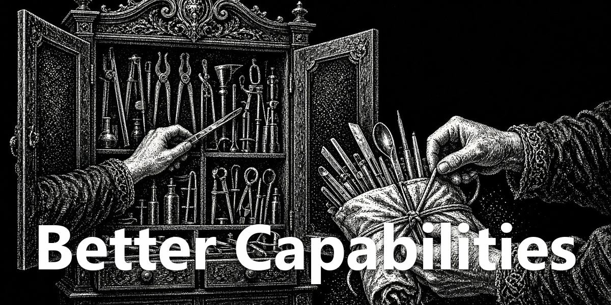

<div align="center">
  <a href="https://github.com/NousResearch/hermes-agent"></a>
  <h1>Better Capabilities</h1>
  <strong>Delete and package skills, browse their files, save on/off presets.</strong>
  <p>A Settings ▸ Plugins page plus a <code>/preset</code> command, for the things the Capabilities page does not cover.</p>
  <p>
    <a href="plugin.yaml"></a>
    <a href="../../LICENSE"></a>
  </p>
</div>

<div align="center">
  
</div>

## Where it lives

Two ways in:

- **The Capabilities row in the sidebar** carries two dim glyphs. The pencil opens this profile's
  Skills editor. The second opens a profile menu with a thin **Skills** header and then a
  **Plugins** header; picking a profile opens that page pinned to it.
- **Settings → Plugins → Better Capabilities**, with an overview, **Skills**, and **Presets**.
  Reachable from the Settings rail and from the gear on the plugin's own row in
  Capabilities → Plugins.

The page adds nothing to the Capabilities page — that page gives plugins no slot to contribute to.
The two sidebar glyphs are injected into the nav row on purpose, because the sidebar has no per-row
SDK hook; that is why this personal edition fails the catalog's `desktop surface` check. See
[LIMITATIONS.md](LIMITATIONS.md).

Picking another profile pins the page to it: skill switches apply to that profile, while delete,
package, folder and file actions stay hidden because those routes act on the window's own profile.

## What you can do

- **Skills.** Filter the list, flip a skill on or off, and read the other markdown files in its
  folder (`references/`, `docs/`, and so on) without leaving the page. Each row also offers
  Package (zip), Open folder, and Delete.
- **Package (zip).** Saves `SKILL.md` plus `references/` and the rest of the folder as a zip.
  `__pycache__`, `.git`, virtualenvs and compiled files stay out, and symlinks are skipped.
- **Delete.** The skill folder goes to the Recycle Bin. When the bin is unavailable — a
  non-Windows host, or a locked folder — it is moved to
  `<hermes home>/better-capabilities-trash/` and the page says which happened.
- **Presets.** Save the current on/off set for skills, toolsets, or agent plugins under a name,
  then apply, overwrite, rename, reorder, or delete it. Presets live in one store, so the page and
  chat see the same list.
- **From chat.** `/preset save skills|tools|plugins {name}` and
  `/preset skills|tools|plugins {name}`.

A plugins preset restores every profile that existed when it was saved. Desktop-plugin switches
are not part of it: the Desktop keeps those app-wide and exposes them to plugins read-only, so a
preset never claims to restore them.

## Install

Requires [Hermes Agent](https://github.com/NousResearch/hermes-agent) with the plugin SDK doors
this page uses — `ctx.registerSettingsPage`, `host.skills`, `host.toolsets`, `host.request`,
`ctx.os` — which is any Desktop build from October 2026 onward.

```bash
hermes plugins pack install https://raw.githubusercontent.com/apoapostolov/hermes-agent-awesome-plugins/main/hermes-pack.yaml
```

Or install just this plugin:

```bash
hermes plugins install apoapostolov/hermes-agent-awesome-plugins/personal/better-capabilities
```

The personal edition loads enabled. After Desktop starts, open **Settings → Plugins → Better
Capabilities** — the same page is reachable from the gear on the plugin's row in
**Capabilities → Plugins**. Zip, delete and the skill file list need the plugin's Python routes,
and those mount when the Desktop backend starts: after adding or updating this plugin, fully quit
and reopen Hermes Desktop once so the routes exist. `/preset` works from chat without that, because
the agent half registers with the running gateway.

## Requirements and limits

Desktop plugin with a small Python API. Skill actions reach only skills under this Hermes home's
`skills/` folder — bundled and hub skills resolve elsewhere and are left alone. Presets cover
skills, toolsets and agent plugins; desktop-plugin switches stay in the app's hands.

See [LIMITATIONS.md](LIMITATIONS.md) for what still keeps this tree off the public catalog, and
[AUDIT.md](AUDIT.md) for the comparison against the current Capabilities page that produced this
design.

## License

[MIT](../../LICENSE)
