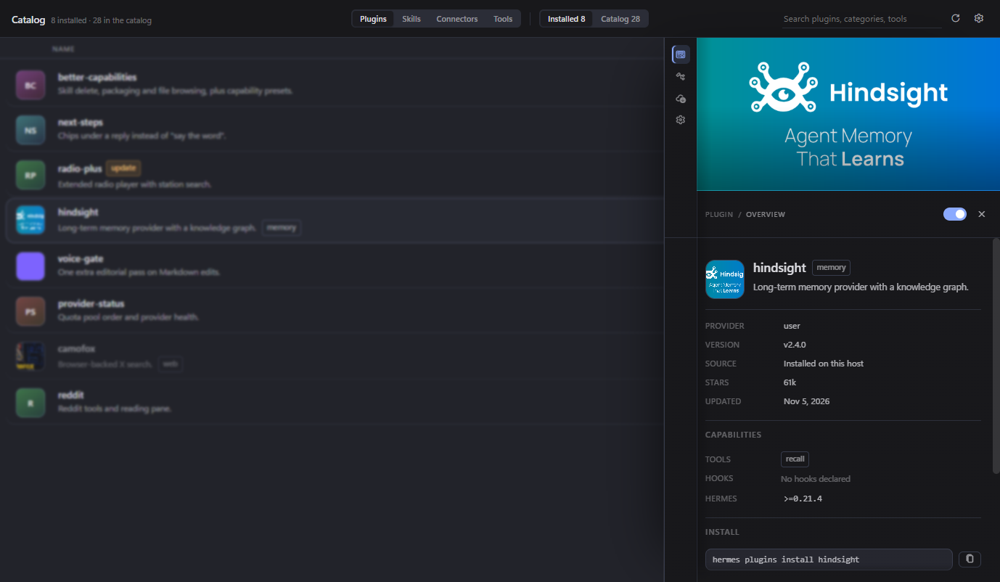
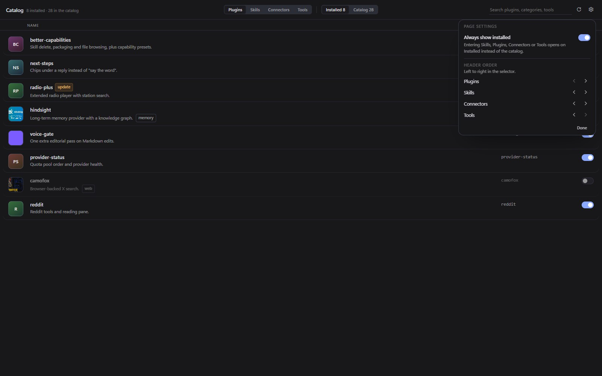

<div align="center">
  <a href="https://github.com/NousResearch/hermes-agent"></a>
  <h1>Catalog Redesign</h1>
  <strong>One page for skills, plugins, connectors and tools.</strong>
  <p>A wide catalog with one row per item, a hover preview, and a detail panel that carries the artwork.</p>
  <p>
    <a href="plugin.yaml"></a>
    <a href="../../LICENSE"></a>
  </p>
</div>

<div align="center">
  
</div>

## Screenshot

<div align="center">
  
</div>

The catalog in the plugins view, with the panel open on a plugin that ships a hero image. The panel's header is that image; the plugin's own thumbnail sits beside its name underneath.

## What You Can Do

- Browse four kinds on one page. Plugins, Skills, Connectors and Tools switch with one control, and each kind keeps its own filters, its own search and its own count. Skills carry a third state: **Installed**, **Archive** and **Catalog**, because a skill the curator retired sits in `skills/.archive`, neither loading nor gone.
- Read a row instead of a card. A row is a thumbnail, the name with its description, and the column that matters for that kind: tags for skills, connectors and tools, the normalized short name for plugins. Columns hold their position down the list, so the third column lines up as a column rather than a caption.
- See artwork, not initials. A published plugin borrows the catalog's hero image; a plugin outside the catalog uses a logo its own folder ships (`icon`, `logo`, `banner`, `hero`, `cover`, `thumbnail` or `preview`, up to 300 KB). A plugin with neither keeps its initials.
- Preview without clicking. Resting on a row for 240 milliseconds opens a card under it with the hero image as a 16:9 band, the description, provider, version, stars and what the item includes. Near the bottom edge the card flips above the row, and it never takes the pointer.
- Open the full record. Clicking a row slides in a panel at 380 to 462px with the hero image across its top, a metadata list, and only the sections that kind has: Overview, Capabilities, Install and Actions for a plugin; Overview, Install and Actions for a skill; Connection for a connector; Tools for a toolset.
- Reach any section from the rail. A 44px icon rail sits on the panel's left edge, and hovering it opens a labelled sheet over the panel. Each icon is also a plain click target.
- Read the online catalog, not a local list. The Catalog filter shows the same published snapshots the native Capabilities page reads: 2,380 plugins and about 104,000 skills, ranked once and served a page at a time, with the total in the header. Reaching the end of the list fetches the next page by itself, and **Load more** is there for anyone who prefers a button.
- Turn things on and off where you read them. Plugins, skills, toolsets and configured connectors carry a switch on the row and in the panel header. A switched-off item is dimmed rather than hidden, and the switch flips at once and flips back if the backend refuses.
- Keep the native page. The plugin adds its own route, sidebar row and palette entry, and never touches the Capabilities row; **Open in native Capabilities** in each panel is the hop between the two.

## Settings

Open the page's gear or **Settings, Plugins, Catalog Redesign**.

<div align="center">
  
</div>

| Setting | Default | What it does |
| --- | --- | --- |
| Always show installed | on | Entering a kind opens on Installed instead of the catalog. |
| Header order | Plugins, Skills, Connectors, Tools | The order of the kind selector in the header, moved left and right per kind. |

## How it works

The plugin has two halves. The renderer draws the page, the hover card and the panel, and registers its own route, sidebar row and palette command. The Python half answers five routes: the two published catalogs, the skills archive, the artwork found in each installed plugin's folder, and the connector switch.

The catalogs come from `nousresearch.github.io/hermes-agent/docs/api`: `plugins.json` and `skills.json`, the same snapshots the native page fetches whole. Pulling 66 MB of skills into a renderer on every window is a cost this page does not pay, so the Python half downloads a snapshot once, keeps the projected rows for thirty minutes, and returns one page of 150. A query runs over that whole snapshot on the server side, which is why search matches rows a reader has not scrolled to yet.

The list paints in two tiers. `plugins.list` answers in milliseconds from the in-memory manager, so rows and the header count appear at once, and `plugins.manage list` follows in the background to add descriptions, sources, update flags and desktop-half facts. A slow detail scan never blanks a painted list, and a snapshot of the last scan lets the next window paint before the scan starts.

## Install

Requires [Hermes Agent](https://github.com/NousResearch/hermes-agent) **0.22.0 or newer**.

```bash
hermes plugins pack install https://raw.githubusercontent.com/apoapostolov/hermes-agent-awesome-plugins/main/hermes-pack.yaml
```

Or this plugin alone:

```bash
hermes plugins install apoapostolov/hermes-agent-awesome-plugins/personal/catalog-redesign
```

Enable **Catalog Redesign** under **Capabilities, Plugins**, then `Ctrl+K` and **Reload window** so the renderer half loads. Restart the app once so the gateway mounts the five routes; until then the page shows rows from the installed list and no catalog.

The page needs Hermes 0.22.0 or newer for `ctx.registerSettingsPage` and the `Switch` control.

## Requirements / Limits

The page is not virtualized: it renders 150 rows at a time and adds the next page when you reach the end, on purpose, to avoid a virtualization dependency. A catalog page needs the network the first time in a thirty-minute window; after that the gateway answers from the snapshot it already parsed, and a disk copy keeps the last good catalog for an offline window. The installed and archive views need no network at all. Hosted connectors are not listed, because their state lives in the app's own store rather than behind an SDK door. The switch covers the agent half of a package, which is what the app follows when it materializes a desktop half; a desktop-only plugin still needs **Capabilities, Plugins** for its interface half. `LIMITATIONS.md` has the details.

## License

[MIT](../../LICENSE)
