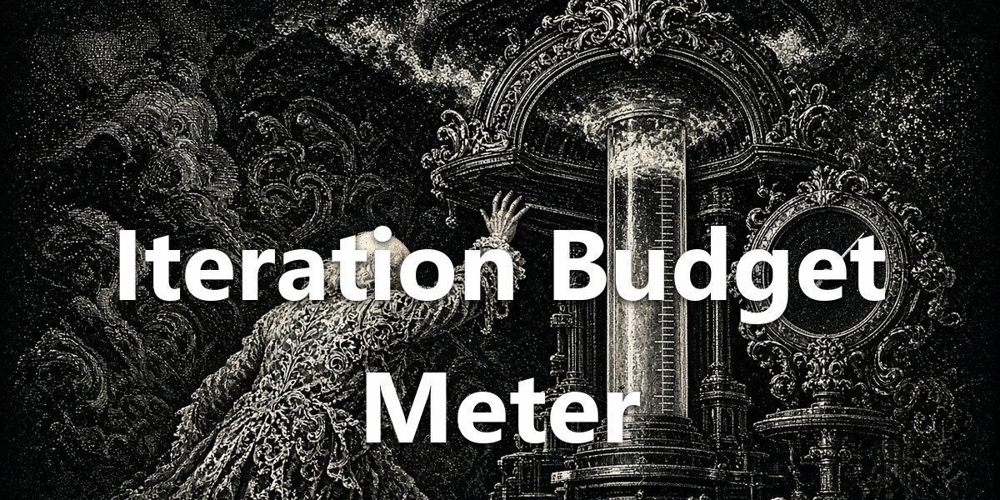
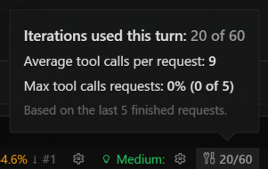

<div align="center">
  <a href="https://github.com/NousResearch/hermes-agent"></a>
  <h1>Iteration Budget Meter</h1>
  <strong>See the session's turns and steps while work runs.</strong>
  <p>Session totals in the status bar. Hover and click for per-turn stats.</p>
  <p>
    <a href="plugin.yaml"></a>
    <a href="../../LICENSE"></a>
  </p>
</div>

<div align="center">
  
</div>

## See It in Action



## What You Can Do

- Watch the focused session's cumulative totals: turns (your messages) and steps (model calls), the same counters the CLI bar keeps.
- Hover for the session overview. Click for the per-turn iterations used, averages, ceiling-hit ratio, and a data-based ceiling suggestion when the numbers support one.
- Totals survive app restarts and compaction, and the step count animates while a turn runs.

## Install

Requires [Hermes Agent](https://github.com/NousResearch/hermes-agent) **0.21.0 or newer**.

```bash
hermes plugins pack install https://raw.githubusercontent.com/apoapostolov/hermes-agent-awesome-plugins/main/hermes-pack.yaml
```

Enable **Iteration Budget Meter** under **Capabilities → Plugins**. The meter appears in the desktop status bar once the focused session's totals load.

## Requirements / Limits

Desktop-only. Budget ceilings stay under Hermes and the connected model configuration. This plugin reports usage; it does not raise the cap for you.

## License

[MIT](../../LICENSE)
