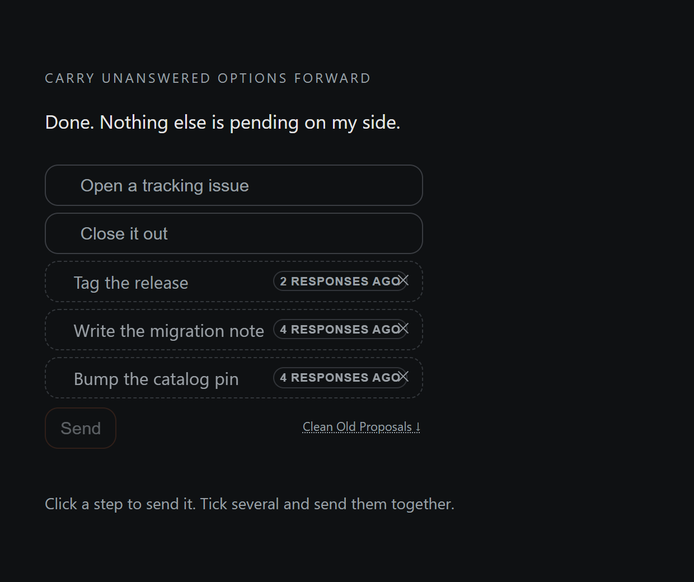

<div align="center">
  <a href="https://github.com/NousResearch/hermes-agent"></a>
  <h1>Next Steps</h1>
  <strong>End a reply with options instead of a promise.</strong>
  <p>Clickable next steps under every reply. Tick several and one send delivers them together.</p>
  <p>
    <a href="plugin.yaml"></a>
    <a href="../../LICENSE"></a>
  </p>
</div>

<div align="center">
  
</div>

## Screenshot

<div align="center">
  
</div>

## What You Can Do

- End a reply with up to six steps instead of "say the word and I'll push it". A click sends that step back as a normal user turn, so the next message is already written.
- Tick several and finish with two buttons. With two or more options the row is multi-select: **Send** carries a count, so three picks become one message with three lines rather than three queued turns, and the small **Steer** button beside it sends the same picks into the turn already running. A block registered with `multi="0"` sends on the first click.
- Answer several points in one turn. When the reply asks questions rather than offers actions, `answer=true` draws a checkbox and a reply field for each option; typing selects that row, and one send delivers `1. <question>: <answer>` lines. A ticked row left blank sends just its numbered question.
- See which options are worth taking now. A decision classifier tags them **Recommended** in the accent tint and they start ticked; several can carry the tag when they belong together, never all of them, and never beside "leave it as it is".
- See which options could cost you something. An option the classifier reads as able to damage files, a build or money carries an amber **RISKY** pill. Off by default.
- Read a label that would otherwise mislead. The agent can attach a dim second line to any chip, clipped at two wrapped lines with the full text on hover.
- Let two options exclude each other. Alternating options are drawn next to each other and picking one greys the other; the option that means leaving things alone closes the row.
- Pick up what earlier replies left unanswered. With carry on, every reply lists those options youngest reply first, each with how many replies back it was offered and an X to drop it, and the queue caps at thirty. A carried label jumps back to the reply that offered it.
- Answer mid-turn. A step clicked while a turn is working joins the queue as the next turn; with steer on it also reaches the live turn so the text lands mid-request, and a refused steer still becomes that queued turn. **Steer** makes that choice per click: on a busy chat it addresses the live turn and never falls back to the queue, warning you instead if the turn refuses it so the block stays unsent and can be retried. On an idle chat it starts a normal turn.

The plugin has two halves. The agent half registers the options through the `next_steps` tool, or writes a `::nextsteps` directive when tool calling is off, and a bundled prompt rule asks it to end a choice that way. The renderer half draws the row under the reply and sends the text back as a normal user turn. Every chip in a block shares one width, set by the longest option, and per-block state survives a reload.

## Settings

Open Settings, Plugins, Next Steps.

| Setting | Default | What it does |
| --- | --- | --- |
| Ask the decision classifier which steps to pick | on | Asks for recommendations before the options are written, one classifier call per reply that offers a choice. |
| Accent the recommended options | on | Keeps the accent tint on a recommended chip that is not ticked. |
| Mark risky options | off | Adds the amber RISKY pill to options that could damage something. |
| Carry unanswered options forward | off | Lists earlier replies' unanswered options under every reply, youngest first. |
| Send a chip result as a steer | off | Makes **Send** try the live turn first when the chat is busy, with the queue as its fallback. The separate **Steer** button is always available and never falls back. |
| Turn a written offer into options | off | Rewrites a closing offer written in prose into the same row before the reply is stored. |

Recommendations and the RISKY pill need a decision classifier plugin loaded, nerve or jev. Without one the chips work exactly the same and are simply never marked.

## What the agent writes

The tool takes `options`, `multi`, `answer`, `recommend`, `alternates`, `risky` and `subtitles`. Without tool calling the same row is a directive:

```
::nextsteps{multi="1" rec="1" risky="2" q1="Push the branch and open the PR" q2="Force-push over the review commit" q3="Write the release note first" d2="Rewrites origin, discarding the commit already there"}
```

`q` attributes are the labels, `dN` a subtitle for option N, `rec` the recommended indexes, `alt` pairs that exclude each other, `risky` the indexes that carry the pill, `carry="1"` records the reply's options for later ones, and `steer="1"` changes what **Send** does on a busy chat. The **Steer** button needs no directive flag; it appears beside Send whenever a block has a finalisation row. `answer="1"` replaces the chip row with a checkbox and reply field per option; `kind="answer"`, the spelling used by Follow-up Chips, works too. `next_steps_recommend` returns the classifier's pick without drawing anything; its numbers go in `rec`, and a call or a `recommend=` attribute printed into the reply instead is removed before the reply is stored.

Answer mode is for a reply that asks several questions, not for choosing between actions:

```
::nextsteps{answer="1" q1="Deploy at 16:00?" q2="Tag v1.3.0?"}
```

## Install

Requires [Hermes Agent](https://github.com/NousResearch/hermes-agent) **0.22.0 or newer**.

```bash
hermes plugins pack install https://raw.githubusercontent.com/apoapostolov/hermes-agent-awesome-plugins/main/hermes-pack.yaml
```

Or this plugin alone:

```bash
hermes plugins install apoapostolov/hermes-agent-awesome-plugins/personal/next-steps
```

Enable **Next Steps** under **Capabilities → Plugins**, then `Ctrl+K` and **Reload window** so the renderer half loads. The agent half is live immediately; the chips appear only after the reload.

Follow-up Chips and Next Steps draw the same slot under a reply, so disable one before enabling the other.

## Requirements / Limits

Desktop plus gateway. A step is a sentence, so a vague option sends a vague request; the plugin does not rewrite what the agent wrote. Ticks are per block, so two blocks open in one reply keep separate picks. The carry queue is stored per chat, and clearing a chat clears its queue. A subtitle is authored by the agent and nothing checks it against the label. The RISKY pill is a classifier's opinion about consequences, not a reading of your repository.

The chip border keeps Hermes' arc animating while a reply works, and a carried label scrolls the transcript back to the reply that offered it. Both reach into the app's own DOM, which is why this edition is not listed in the catalog; [LIMITATIONS.md](LIMITATIONS.md) names the hooks they need.

## Where this comes from

An extended edition of **Follow-up Chips** ([nuonrg/hermes-plugin-followup-chips](https://github.com/nuonrg/hermes-plugin-followup-chips)), which it grew out of and still shares the idea with: a reply ends with clickable options, and a click sends one back as the next turn. Next Steps carries that further with the classifier marks, subtitles, the alternating and deferral ordering, the carry-forward queue, and the steer setting.

## License

[MIT](../../LICENSE)
