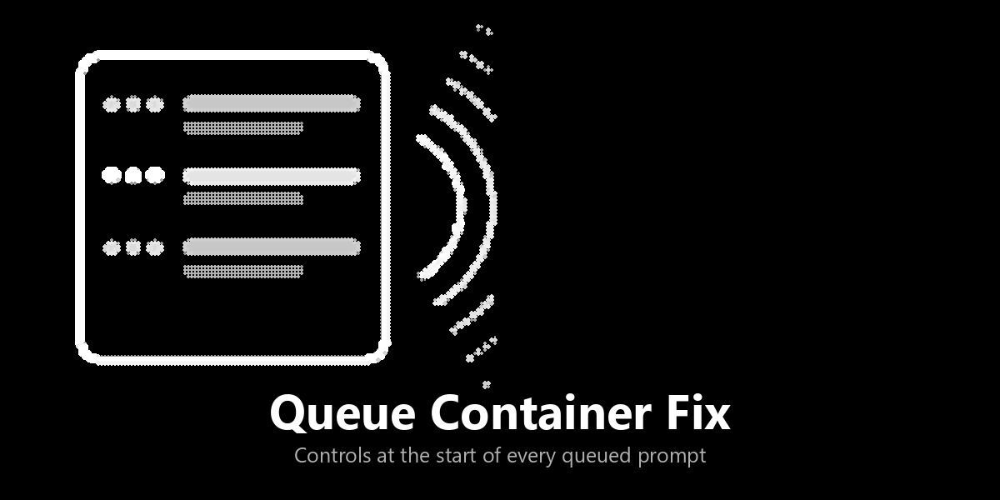
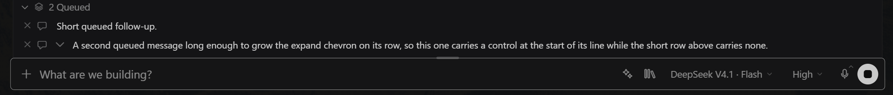

<div align="center">
  <a href="https://github.com/NousResearch/hermes-agent"></a>
  <h1>Queue Container Fix</h1>
  <strong>Queued prompts with their controls where you can reach them.</strong>
  <p>The steer, edit and remove controls sit at the start of each queued message instead of past the end of it.</p>
  <p>
    <a href="plugin.yaml"></a>
    <a href="../../LICENSE"></a>
  </p>
</div>

<div align="center">
  
</div>

## Screenshot

<div align="center">
  
</div>

## What You Can Do

- Reach the controls on the first line. A queued prompt used to draw its expand, edit, steer and send buttons in the last column of the row, past the end of the message text. On a long prompt those buttons sat at the far right edge, and they only appeared while the pointer was over the row. They now come before the message text, so they are at the start of the first line where the eye already is.
- See them without hunting for a hover. The controls rest at a little over half strength and come to full on row hover or keyboard focus, so a queued row advertises what can be done to it.
- Keep the row compact. The control column takes only the width of the buttons that row actually has. A queued prompt with no controls, which is what a gateway-owned entry looks like while it is already running, keeps its text at the left margin instead of leaving blank space.
- Leave everything else alone. Background commands, subagents and artifact rows are not queued prompts and keep their controls at the end of the row. Nothing about sending, queueing, steering or editing changes; only where the controls are drawn.

## Install

The pack:

```bash
hermes plugins pack install https://raw.githubusercontent.com/apoapostolov/hermes-agent-awesome-plugins/main/hermes-pack.yaml
```

This plugin alone:

```bash
hermes plugins install apoapostolov/hermes-agent-awesome-plugins/personal/queue-container-fix
hermes plugins enable queue-container-fix
```

Then turn it on in Capabilities, Plugins. A plugin that ships an agent package with a desktop half loads that half opt-in, whatever `plugin.yaml` says, so this toggle is one click and the change lands without a restart.

## Requirements and Limits

- Desktop only. No agent tools, hooks, settings, network calls or stored data.
- It restyles app-rendered markup through the `composer-status-stack` and `status-row` slots, the way a CSS override does. A desktop release that renames those slots or the queue row's glyph retires it, and the fix then belongs upstream. See `LIMITATIONS.md`.
- The plugin is personal-tree only for that reason. Catalog review does not accept a plugin that patches house DOM.

## License

[MIT](../../LICENSE)
