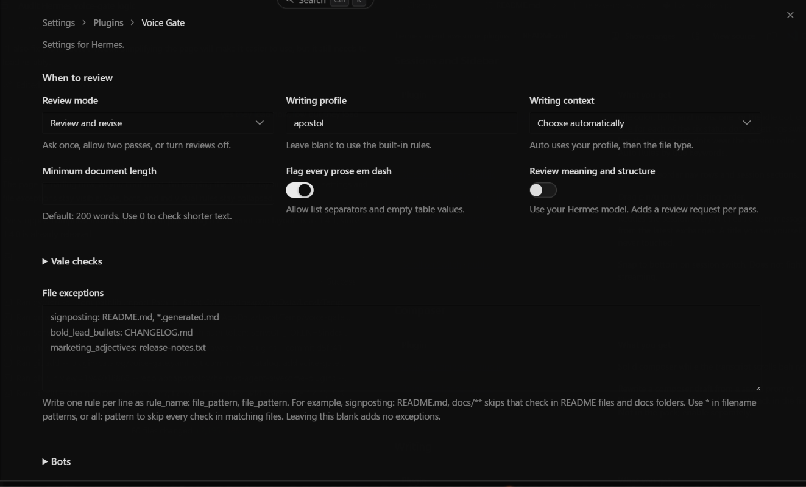

# Voice Gate


Voice Gate reviews prose files Hermes changes before a turn finishes. It finds wording and structural patterns that deserve another read, then asks for a source-faithful revision or an explanation for keeping the passage. A match is an editorial signal, not evidence of AI authorship.


## What it checks

The built-in checker has 75 rule families. They cover stock phrases, vocabulary bands, repeated sentence shapes, formatting, and text left over from an assistant or draft. Documentation conventions, code, quotations, and exact syntax receive different treatment from ordinary prose.

The complete humanizer skill and all nine references are included as a versioned review contract. [The comparison](docs/HUMANIZER-COVERAGE.md) maps all 110 catalog patterns to the implementation, records defects fixed since 1.3.5, and explains the remaining limits. Rules about evidence, coherence, reader priorities, narrative, and voice need contextual judgment. Turn on **Review meaning and structure** to use your selected Hermes model for those checks. This sends the reviewed documents to that model's normal provider and adds a request per pass.

**Ask once** (`warn`) raises findings once. **Review and revise** (`improve`) allows at most two review opportunities, compares protected material and quantities, and reports lack of progress. **Off** (`skip`) disables automatic review. The hook runs on changed files reported by Hermes; ordinary chat replies need an explicit tool check.

Markdown, plain text, reStructuredText, AsciiDoc, Org, LaTeX, HTML, and simple text PDFs are supported. The PDF reader does not provide OCR or reconstruct complex font mappings and layouts. Preservation checks recognize Markdown spans and quantity changes; they cannot prove semantic equivalence.

## Settings



Open Settings, Plugins, Voice Gate. Everyday review settings and file exceptions stay visible. Vale, bots, and individual checks sit in collapsed sections; Advanced rules groups the checks by purpose. Settings are saved for the profile named on the page. The installed-plugin inventory can take more than 30 seconds on a large installation. Loading and saving allow up to two minutes, and a failed load offers Try again. Repeated mounts share the same pending load. Older Desktop builds without the settings-page SDK keep the generated settings form.

Prose em dashes are flagged by default. A bullet label separator such as `- Status — Ready` and a table cell containing only `—` are formatting and remain allowed. A prose sentence in a bullet or table still follows the prose policy. Code, quotes, and literal examples remain protected.

The full-width **File exceptions** box shows five rows and a dim example until you enter text. Write one rule per line, followed by a colon and comma-separated filename patterns:

```text
signposting: README.md, docs/**
bold_lead_bullets: CHANGELOG.md
marketing_adjectives: *.generated.md
pattern_97: stories/**
all: vendor/**
```

Use the family name without `tell_`, a catalog key from `pattern_1` through `pattern_110`, or `all` for every check. A filename matches at any depth; `docs/**` matches a docs subtree, including absolute paths. Exceptions apply only when a check has a file path. Turning off a family also removes its turn-time Vale findings.

## Tools

- `voice_gate_check` checks text or paths and returns findings, review guidance, and gate eligibility.
- `voice_gate_review` returns the review plan, runs optional model analysis, or records an assessment tied to the exact file contents. A recorded assessment cannot waive changed protected material or the strict prose-dash policy.
- `voice_gate_vale` reports status, checks files, or installs the pinned Vale executable.

## Vale

[Vale](https://github.com/vale-cli/vale#install) is a local prose style checker. It is an independent project; the Microsoft writing style can be installed as a Vale style package. The settings page explains Vale above its controls and links to its GitHub installation guide.

Leave **Vale executable** blank to search the plugin-managed copy and PATH. The bundled style pack needs no download. Optional installation verifies the archive against a digest pinned in the plugin before extracting it. Status, checking, and installation request approval before starting a program. Approval directives need Hermes v2026.7.7 (semver 0.18.1); this plugin requires Hermes 0.22.0 or newer.

Vale is off by default. Its turn-time findings respect family switches and file exceptions; standalone Vale uses the generic pack and does not reproduce a personal profile. The Python checker works without Vale or model review.

## Install and update

```sh
hermes plugins install apoapostolov/hermes-agent-awesome-plugins/personal/voice-gate
```

Restart Hermes Desktop after updating so both halves load the same version.

## Development checks

Run the Python scripts in `tests/`, `python scripts/check_style_pack.py`, and `node tests/test_settings_page.mjs`. Set `HERMES_AGENT_ROOT` to a Hermes checkout with Desktop dependencies installed for the settings test. The test mounts the actual page with an SDK fixture and checks scoped loading, editing, validation, and saving; it is not a screenshot test.

## Personal writing profiles

This edition also registers `voice_gate_profile`, `voice_gate_learn`, and the voice-profile-builder skill. Load an approved JSON profile from `HERMES_HOME/voice-profiles`, or supply its path. YAML profiles use the host's optional `ruamel.yaml` support; PyYAML is not required. An invalid profile is reported and falls back to the built-in rules.

Learning accepts explicitly curated author samples and saves a draft for review. It does not infer bans from absent punctuation, reverse frequent author signatures into prohibitions, overwrite an existing profile, or establish authorship. Private profiles and author corpora are not shipped with the plugin.
