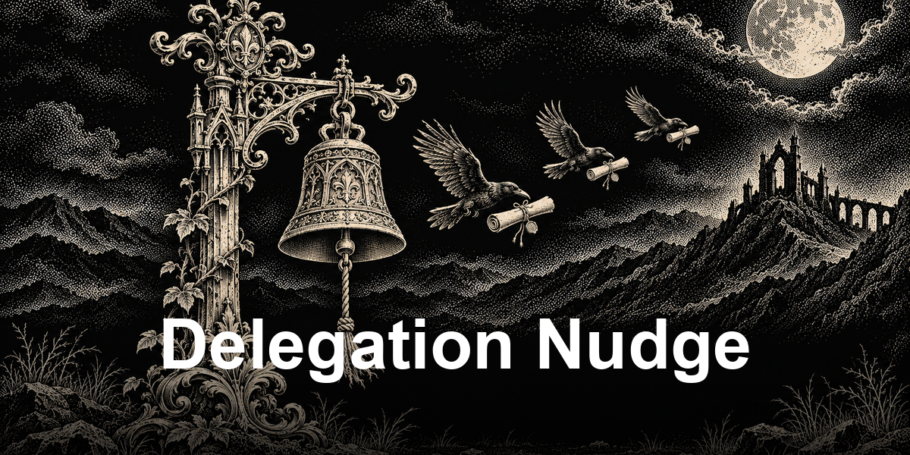

<div align="center">
  <a href="https://github.com/NousResearch/hermes-agent"></a>
  <h1>Delegation Nudge</h1>
  <strong>A live reminder that a turn is spending its own context on work a subagent should carry.</strong>
  <p>Counts the tool results a turn is carrying, names the configured routes, and asks for a reason when the turn declines.</p>
  <p>
    <a href="plugin.yaml"></a>
    <a href="../../LICENSE"></a>
  </p>
</div>

<div align="center">
  
</div>

## What it does

A long turn is usually one decision away from being cheaper. Hermes can hand reading, sweeping and independent items to a subagent on a free or cheap route, but nothing in a busy thread notices when that hand-off should have happened. This plugin notices, names the routes it would use, and asks the model to either dispatch or say why not.

It watches each outbound provider request and counts the tool results in the current turn. Past ten, it appends one short note to that turn's user message. The routes in the note are read from `delegation.backends.model_map` in `config.yaml`, so they carry the provider, the model and whether it is free. Change the model map and the note follows.

A decline is asked to be explicit: one sentence saying why the work cannot leave the thread. That sentence is what makes a nudge measurable, because a silent decline and a dispatched turn look identical from outside.

Nothing renders in the app. The reminder reaches the model, not the window, which is why this edition has no screenshot.

## How it decides

| Step | Behaviour |
| --- | --- |
| Count | Tool results in the current turn, reset at every user message. Loop iterations only stand in when no results are visible, because a turn batching three tools per round would otherwise reach the threshold with three times the results |
| First note | Ten results, naming the routes from your model map |
| Second note | Twenty-five results, naming the bill: every one of those results is carried in this thread's context |
| Cap | Two notes per turn, then silence |
| Dispatch | One `delegate_task` in the turn silences the rest of it |
| Subagents | Silent inside a subagent, where `delegate_task` is not available |
| Failure | A middleware that raises is logged and skipped by the runtime, so a request is never broken |

## Settings

| Setting | Default | What it does |
| --- | --- | --- |
| Enable the reminder | on | Turns the whole plugin off without uninstalling it |
| Tool results before a reminder | 10 | When the first note appears |
| Second note at | 25 | When the escalation appears; set it at or below the threshold to run with one note |
| Remind again every N further results | 0 | 0 uses the two-note ladder above instead of a fixed repeat |

Settings live in `config.yaml` under `plugins.entries.hermes-delegation-nudge.settings`.

## What the agent sees

First note:

```text
[delegation check] 12 tool results this turn, none of them delegate_task. If what is left is
reading, sweeping or independent items, dispatch now: scan (free) opencode-go/hy4-flash-free for
file sweeps and lookups; research (free) opencode-go/beam-free for web and document research;
deep (cheap) opencode-go/deepseek-v4.1-flash for hard debugging and design; code (cheap)
opencode-go/deepseek-v4.1-flash for edits and tests. Children run on those routes, so a dispatch
costs this thread no context and almost no model budget. If the work genuinely needs this thread's
context, or the caller needs an answer mid-task, stay inline and say so in one sentence ("staying
inline because ...") so the decline is a decision, not a silence.
```

Second note, if the turn keeps going:

```text
[delegation check, second call] 27 tool results in this single turn and still no delegate_task:
all 27 are carried in this thread's context. What is already finished stays finished; what remains
can go out as scan (free) opencode-go/hy4-flash-free ... Dispatch the remainder, or write one
sentence saying why it cannot leave this thread.
```

## Install

```bash
hermes plugins install apoapostolov/hermes-agent-awesome-plugins/public/hermes-delegation-nudge
```

Then enable it once:

```bash
hermes plugins enable hermes-delegation-nudge
```

Enabling reloads the plugin set, so the middleware goes live in a running gateway. A turn already in flight fires at its first request after the reload, which is why the first log lines can carry a number larger than your threshold.

## This edition and the SDK

The listed edition uses one `llm_request` middleware, three hooks (`subagent_start`, `subagent_stop`, `on_session_delete`) and one read of `config.yaml` cached for a minute. It touches no app DOM, writes nothing, and makes no network calls. The personal edition in this repository behaves identically; there is no cut feature to disclose.

## Requirements and limits

- The reminder is a hint, not a gate. A turn that decides to keep working inline is allowed to, because a plugin cannot see why a caller is waiting.
- The count is a proxy for context, not a measurement of it. A turn with ten small results is cheaper than a turn with three enormous ones.
- The routes in the note are labels, not routing. The plugin never dispatches on its own.
- Proof it is running: `grep "delegation-nudge: stage" %LOCALAPPDATA%/hermes/logs/agent.log`.
- Turn it off with `hermes plugins disable hermes-delegation-nudge`.

## Tests

```bash
cd public/hermes-delegation-nudge
python -m unittest discover -s tests -t .
```

Sixteen tests drive the middleware with a fake context: both payload shapes, the results-based count, routes read from a temporary `config.yaml`, the fallback label, the escalation, the two-note cap, dispatch silence, subagent silence, the disabled switch, `repeat_after`, and the guarantee that no tool result is ever edited.

## Changelog

[CHANGELOG.md](../../CHANGELOG.md) carries the entries for both editions under this plugin's name.

## License

[MIT](../../LICENSE)
