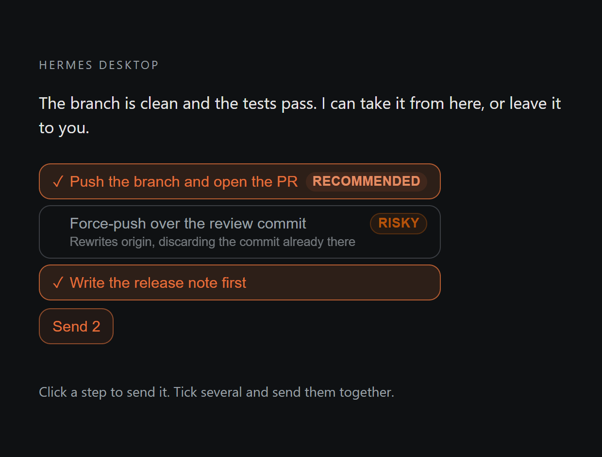
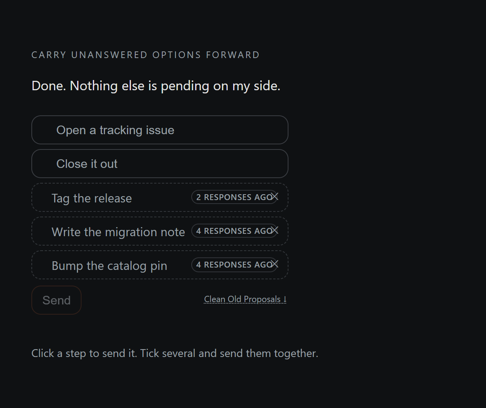

# Next Steps

<div align="center">
  
</div>

Next Steps puts the end of a reply to work. Instead of the agent asking "say the word and I'll push the branch", the reply ends with a row of clickable steps, and one click sends that step as the next message. Tick several and one send delivers them together.

The plugin has two halves. The agent half registers the options through the `next_steps` tool, or writes a `::nextsteps` directive when tool calling is off, and a bundled prompt rule tells it to end a choice that way. The renderer half draws the row under the reply, in the transcript, and sends the text back as a normal user turn.

## Where this comes from

An extended edition of **Follow-up Chips** ([nuonrg/hermes-plugin-followup-chips](https://github.com/nuonrg/hermes-plugin-followup-chips)), which it grew out of and still shares the idea with: a reply ends with clickable options, and a click sends one back as the next turn. Next Steps carries that further with the classifier marks, subtitles, the alternating and deferral ordering, the carry-forward queue, and the steer setting.

Both plugins draw the same slot under a reply, so run one of them: disable Follow-up Chips before enabling Next Steps.

## What a row does

- A click sends that option as the next turn. With two or more options the row is multi-select: ticks pick steps and the send button carries a count, so three clicks become one message with three lines rather than three queued turns. A block registered with `multi="0"` sends on the first click instead.
- Options the decision classifier prefers carry a **Recommended** tag and the accent tint, and start ticked. Several may be recommended when the steps belong together, never all of them, never two that exclude each other, and never "leave it as it is" beside an action.
- An option the classifier reads as able to damage something carries an amber **RISKY** pill. Off by default, because advice about consequences is worth having only when it is asked for.
- Two options that exclude each other are drawn next to each other, and the option that means leaving things alone closes the row. Picking one greys the other.
- A chip can carry a dim second line when the label alone would be read wrongly, clipped at two wrapped lines with the full text on hover.
- Every chip in a block shares one width, set by the longest option, so a row of short actions still reads as a column.
- Per-block state survives a reload; a new block starts blank.

## Options that outlive their reply

A row is only reachable while it is on screen, and in a queued session the next reply buries it. With **Carry unanswered options forward** on, every reply also lists the options earlier replies left unanswered, youngest reply first, each labelled with how many replies back it was offered and an X to drop it. Picking a step or pressing its X retires it, and the queue caps at thirty, keeping recommended proposals ahead of confirmed unmarked ones.



## Working mid-turn

A step clicked while the agent is working joins the queue as the next turn, on or off. With **Send a chip result as a steer** on, it also steers the live turn so the text lands mid-request; a refused steer falls back to that queued turn. Nothing is ever submitted as a request that no turn will run.

## Install

```
hermes plugins install apoapostolov/hermes-agent-awesome-plugins/public/next-steps
```

Then enable it and reload the window so the renderer half loads:

```
hermes plugins enable next-steps
```

`Ctrl+K`, then **Reload window**. The agent half is live immediately; the chips appear only after the reload.

## Settings

| Setting | Default | What it does |
| --- | --- | --- |
| Ask the decision classifier which steps to pick | on | Asks for recommendations before the options are written. One classifier call per reply that offers a choice. |
| Accent the recommended options | on | Keeps the accent tint on recommended chips that are not ticked. |
| Mark risky options | off | Adds the RISKY pill to options that could damage files, a build, or money. |
| Carry unanswered options forward | off | Lists earlier replies' unanswered options under every reply, youngest first. |
| Send a chip result as a steer | off | A step clicked mid-turn steers the running answer instead of queueing. |
| Turn a written offer into options | off | Rewrites a closing offer written in prose into the same row before the reply is stored. |

Recommendations and the RISKY pill need a decision classifier plugin (nerve, or jev). Without one, the chips work exactly the same and are simply never marked.

## What the agent writes

The tool takes `options`, `multi`, `recommend`, `alternates`, `risky` and `subtitles`. Without tool calling the same row is a directive:

```
::nextsteps{multi="1" rec="1" risky="2" q1="Push the branch and open the PR" q2="Force-push over the review commit" q3="Write the release note first" d2="Rewrites origin, discarding the commit already there"}
```

`q` attributes are the labels, `dN` a subtitle for option N, `rec` the recommended indexes, `alt` pairs that exclude each other, `risky` the indexes that carry the pill, `carry="1"` records the reply's options for later ones, and `steer="1"` asks a click to steer the live turn.

## Limits

- A step is a sentence, so a vague option sends a vague request. The plugin does not rewrite what the agent wrote.
- Ticks are per block. Two blocks open in one reply keep separate picks, and neither sees the other.
- The carry queue is stored per chat: options from one chat never appear in another, and clearing a chat clears its queue.
- A subtitle is authored by the agent. Nothing checks it against the label, so a wrong clarification is caught by you, not by the plugin.
- The RISKY pill is an opinion about consequences from a classifier reading labels and context, not a reading of your repository.
- This is the listing edition. The personal edition also animates the chip border while a reply is working and lets a carried label scroll back to the reply that offered it; both need app-side hooks the catalog does not allow yet, so neither ships here.

## Licence

MIT. The upstream plugin it extends is MIT as well.
