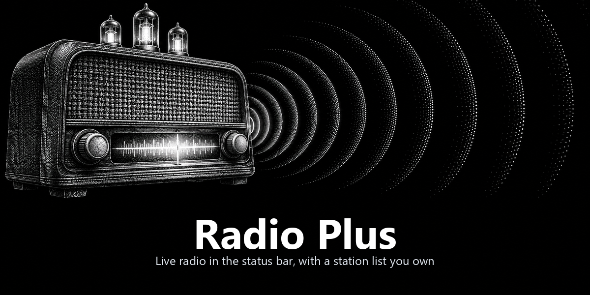
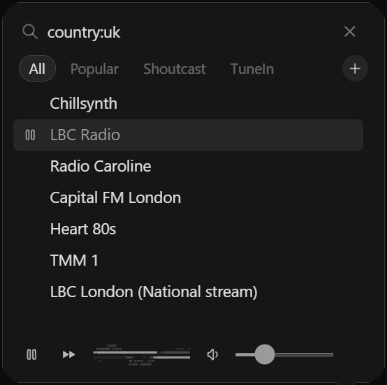

<div align="center">
  <a href="https://github.com/NousResearch/hermes-agent"></a>
  <h1>Radio Plus</h1>
  <strong>Live radio in the status bar, with a station list you own.</strong>
  <p>An extended edition of the bundled Radio plugin: editable stations, three directories, and a station log that says why a stream will not play.</p>
  <p>
    <a href="plugin.yaml"></a>
    <a href="../../LICENSE"></a>
  </p>
</div>

<div align="center">
  
</div>

## Screenshot

<div align="center">
  
</div>

## Where this comes from

Radio Plus starts from the **Radio** plugin bundled with Hermes Desktop
(`apps/desktop/src/plugins/radio`, MIT, Nous Research) and keeps what makes it
good: the braille oscilloscope, the status-bar transport, artist links through
Apple Music and MusicBrainz, the dictation-aware pause and resume, and the
one-window playback lock. That plugin is the reason this one exists.

What it extends, in the direction of any station rather than seven fixed ones:

- The seven shipped stations were a fixed array in the source. Here they are a
  seeded starting list that you rename, re-point, delete, or add to.
- The picker searched one directory. It now searches Radio Browser, Radio
  Browser's popular list and the Shoutcast directory, and it crosses scripts so
  a Bulgarian name typed in Cyrillic finds the Latin spelling the directories
  index.
- A station that will not play now says why, in the panel and in a log line,
  instead of failing silently.

The bundled plugin and this one draw the same status-bar slot. Enable one of
them; both enabled means two players in one bar.

## What You Can Do

- Hover a row and use the pencil to edit a station. The editor carries the name
  and the stream address together, so a station can be renamed and re-pointed at
  a new mount in one place. The bin deletes on a second click and disarms itself
  after four seconds.
- Add a station from any address with the round button at the end of the source
  row. The address is checked before it is saved, so a website URL is refused
  with a reason instead of becoming a station that never plays.
- Search three sources. *All* mixes your stations with a Radio Browser name
  search, *Popular* lists Radio Browser's most-voted stations, and *Shoutcast*
  searches the Shoutcast directory by name, genre, or keyword. With an empty
  search box the Shoutcast chip lists the busy end of the directory.
- Narrow the search with tags. `country:uk` lists stations from the United
  Kingdom and `genre:jazz` lists jazz, in any combination with a name, as in
  `sunrise country:uk genre:ambient`. The field's placeholder shows both. Two
  letters are read as an ISO country code, a longer word as a country name, and
  a few short names map to their code, so `uk` finds GB and `usa` finds US.
  Quotes hold a value with a space: `genre:"smooth jazz"`. A tag query browses
  the directory, so your own stations step aside instead of sitting on top of the
  results; the Shoutcast source understands a genre tag but has no country
  index.
- Scroll for more, on all three sources. A search and the Popular list arrive
  forty at a time and ask for the next page when you reach the bottom, so a broad
  query like `genre:jazz` costs one page up front instead of every row the
  directory holds. Shoutcast pages thirty at a time, because every row there
  costs a resolve and a probe before it can play. The list says when it is
  loading, and it stops asking once a page comes back short or adds nothing new.
- Search in Cyrillic or Latin. A Cyrillic query is also sent transliterated, so
  `Хоризонт` reaches `BNR Horizont` and `Христо Ботев` reaches its entry.
  Local matching folds both scripts the same way.
- HLS stations are hidden here and counted. A playlist address needs a demuxer
  this edition does not carry, so those rows are left out of the results and the
  panel says how many were left out.
- Read why a station failed. The panel shows the media error and the host it
  tried, and the plugin route records the failure in
  `radio-plus/station-log.jsonl`. The add form and the failure path both use the
  same probe, which reports what an address actually returns.
- Skip the dead rows. Every resolved Shoutcast address is probed
  before it reaches the list, under a two-second budget, so a directory entry
  that now serves an HTML error page is dropped and counted rather than played.
- See what is on air. The panel's track line shows the title the stream itself
  announces, split into artist and song, with the artist's profile link. That
  works for any station in the list, including a Radio Browser row or an address
  you added yourself, because the plugin route reads the ICY metadata the player
  cannot. A Shoutcast row that already knows what was playing fills the line
  until the stream's first announcement.

## Settings

Settings, Plugins, Radio Plus holds one switch and one button.

**Start the last station on launch** is off by default. With it on, the station you listened to last starts playing as soon as Hermes opens, so the status bar is live without a click. With it off, nothing plays until you press play, and a station that cannot be reached reports the reason in the panel instead of retrying.

The switch is read once, at launch. Flipping it during a session changes what the next launch does and never starts audio behind you. It is stored with the plugin's own data, not in app config, and a station you have never played does not count as a station to resume.

**Restore the default stations** puts back any of the seven starter stations that is no longer in your list, and says how many it restored. It only adds: stations you added yourself stay, and a starter station you renamed keeps your name, because the check is by identity rather than by name. Pressing it twice adds nothing the second time and says the list is already complete.

## Install

The pack:

```bash
hermes plugins pack install https://raw.githubusercontent.com/apoapostolov/hermes-agent-awesome-plugins/main/hermes-pack.yaml
```

This plugin alone:

```bash
hermes plugins install apoapostolov/hermes-agent-awesome-plugins/public/radio-plus
hermes plugins enable radio-plus
```

This is the listed edition. It stays inside the plugin SDK (`ctx.register`,
`ctx.storage`, `ctx.rest`, `ctx.os.openExternal`) plus its own dashboard route.
Two features are personal-only: **HLS playback** and **TuneIn**. The listed tree
cannot carry the vendored `hls.js` build, because the admission scanner refuses a
library that defines accessors on its own prototypes, and loading it from a CDN
would run remote code in the renderer; here an HLS station is hidden from the
results and the panel says how many were hidden. TuneIn is an undocumented
endpoint whose terms describe personal listening, so a listing does not call it;
the picker carries three sources instead of four. Everything else, including the
Shoutcast search, the transliterated queries, the track line and the station log,
is identical.

Enable it in Capabilities, Plugins. The renderer half loads on that toggle or on
an app restart. The Shoutcast and now-playing routes need the app
restarted once, because the
dashboard mounts plugin routes at startup; until then that chip reports itself
unavailable and everything else works.

The bundled Radio plugin should be disabled while this one is enabled.

## Tests

`node tests/settings.test.mjs` renders the settings page with the app's own React
and jsdom, flips the switch the way a user does, and reads the stored key back.

## Requirements and Limits

- A track line depends on the station announcing one. Most Icecast and Shoutcast
  mounts do; an HLS-only station, or a stream that never sends ICY metadata, shows
  the station's own description or nothing.
- Shoutcast search is slower than the other sources, because a search resolves each
  station's tune-in file and probes the result before answering, so the first
  search of a term takes a few seconds and later ones come from cache.
- Waveform analysis needs CORS on the stream itself. A station that refuses
  it plays without a waveform and shows an activity indicator rather than
  invented levels.
- Directory data is theirs: availability, regional restrictions, and
  metadata quality belong to Radio Browser and Shoutcast.
- No accounts, keys, or telemetry. Streams connect directly to broadcasters.
  Searches send the typed term to Radio Browser, or to Shoutcast through the
  plugin's own local route, which also reads the track a playing station
  announces. Two hosts are contacted and no others: Radio Browser and the
  Shoutcast directory with its tune-in files, plus whichever station you are
  playing when the panel asks what is on air. The route refuses loopback and
  private addresses, so it cannot be turned into a scanner for your network, and
  nothing is sent anywhere except the term you typed.

## Tests

```bash
py -m pytest tests/test_plugin_api.py -q
RADIO_PLUS_LIVE=1 py -m pytest tests/test_plugin_api.py -q
node tests/desktop.test.mjs
node tests/panel.test.mjs
node tests/hls.electron.test.mjs
```

The last one loads the shipped `plugin.js` in Electron, points `attachHls` at a
real BNR stream, and requires the audio clock to advance, which is the only
honest test of an HLS path.

`docs/screenshot-tags.png` is a capture of the running app: a second Hermes
instance with a copy of the real profile, `country:uk` typed into the picker,
the app chrome hidden so the panel's translucency composites on one colour, then
cropped to the popover. `docs/screenshot.png` is the same rig with the search
field empty, so it shows the stored stations instead. `docs/hero.png` is a stipple illustration with the title overlaid.
`docs/icon.png` is the mark, drawn in code so it stays crisp at 48px.

## License

[MIT](../../LICENSE) © Apostol Apostolov. The vendored `hls.js` build is MIT,
© its contributors; its banner in `desktop/plugin.js` records the version and
digest.
